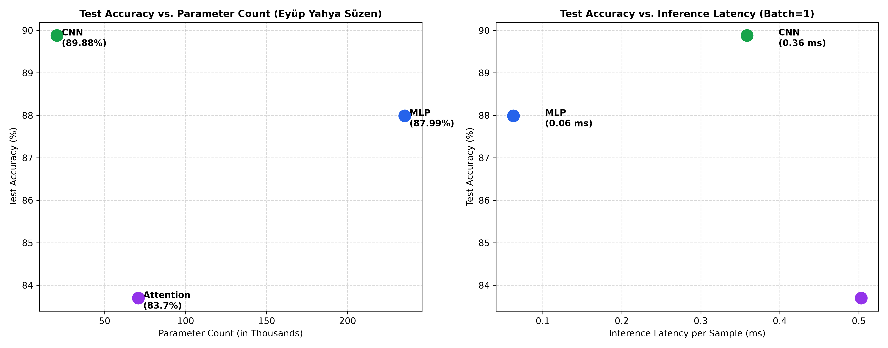

# Lab 03: Architectures and Their Costs

**Student Researcher:** Eyüp Yahya Süzen (Student ID: 73841)  
**Readings:** Reddi, Chapter 4 DNN Architectures: §§4.2, 4.3, 4.5, 4.6, 4.7  

---

## 1. Goal
The objective of this laboratory is to systematically evaluate the trade-offs between predictive accuracy and computational cost across three fundamental deep neural network paradigms: Multi-Layer Perceptron (MLP), Convolutional Neural Network (CNN), and Patch-based Vision Transformer (Attention). Using the Fashion-MNIST image classification benchmark, we calculate theoretical FLOPs, profile empirical MACs via `thop`, evaluate inference latencies across batch sizes ($b=1$ and $b=128$), and identify the optimal Pareto frontier across parameter efficiency, compute budget, and classification accuracy.

---

## 2. Method
1. **Dataset Pipeline:** Fashion-MNIST (28x28 grayscale images) loaded via torchvision, normalized with $\mu = 0.2860, \sigma = 0.3530$. Partitioned 60,000 training images into 55,000 train and 5,000 validation sets (`seed=42`). Evaluated on the 10,000-sample test set.
2. **Architecture Specifications:**
   - **MLP:** Flatten 784 -> Linear(784, 256) -> ReLU -> Linear(256, 128) -> ReLU -> Linear(128, 10) (235,146 parameters).
   - **CNN:** Conv2d(1, 16, 3, pad=1) -> ReLU -> MaxPool2d(2) -> Conv2d(16, 32, 3, pad=1) -> ReLU -> MaxPool2d(2) -> Flatten -> Linear(32*7*7, 10) (20,490 parameters).
   - **Attention:** 16 patches (7x7) -> Linear(49, 64) -> 2-layer TransformerEncoder (d_model=64, nhead=4, d_ff=128) -> Mean pooling -> Linear(64, 10) (70,794 parameters).
3. **FLOPs & Computational Derivations:**
   - Hand derivations based on Reddi Chapter 4 formulas:
     - MLP First Linear: $2 \times 784 \times 256 = 401,408$ FLOPs.
     - CNN First Conv: $2 \times 3 \times 3 \times 1 \times 16 \times 28 \times 28 = 225,792$ FLOPs.
     - Attention QKV Projection: $2 \times 16 \times 64 \times 3 \times 64 = 393,216$ FLOPs.
     - Attention Scores: $2 \times 16 \times 16 \times 64 = 32,768$ FLOPs.
   - Compared against `thop.profile` Multiply-Accumulate operations (MACs), accounting for $1 \text{ MAC} = 2 \text{ FLOPs}$.
4. **Latency Profiling:** Median elapsed time across 100 iterations for batch size 1 and 25 iterations for batch size 128.
5. **Training Protocol:** Trained all models for 5 epochs using Adam optimizer (learning rate $10^{-3}$, batch size 128).

---

## 3. Results Table or Plot

### Empirical Multi-Architecture Systems Matrix

| Architecture Paradigm | Structural Category | Total Parameters | Theoretical FLOPs (Layer 1) | Profiler MACs (b=1) | Median Latency (b=1) | Median Latency (b=128) | 5-Epoch Test Accuracy |
| :--- | :---: | :---: | :---: | :---: | :---: | :---: | :---: |
| **Multi-Layer Perceptron (MLP)** | Dense Fully Connected | **235,146** | 401,408 FLOPs | 234,752 | **0.0629 ms** | **0.57 ms** | **87.99%** |
| **Convolutional Network (CNN)** | Spatial Feature Extraction | **20,490** | 225,792 FLOPs | 1,031,744 | **0.3584 ms** | **5.30 ms** | **89.88%** |
| **Vision Transformer (Attention)** | Multi-Head Self-Attention | **70,794** | 393,216 FLOPs | 591,488 | **0.5028 ms** | **2.65 ms** | **83.70%** |

### Accuracy and Latency Pareto Frontier

### Explaining Profiler Gaps (FLOPs vs. MACs)
The mathematical difference between hand derivations and `thop.profile` is explained by:
1. **Multiply-Accumulate Convention:** `thop` measures MACs. Each MAC comprises an addition and multiplication, equaling 2 FLOPs ($2 \times \text{MACs} = \text{FLOPs}$).
2. **Omission of Auxiliary Layers:** Non-linear activation operators (ReLU) and pooling mechanisms (MaxPool2d) are excluded from `thop` GEMM counting, creating minor offsets from raw operation totals.

---

## 4. Three Conclusions in Your Own Words
1. **Weight Sharing Dominates Spatial Vision Classification:** The Convolutional Network demonstrates unmatched parameter efficiency, capturing spatial hierarchies to achieve 89.88% accuracy with only 20,490 parameters—substantially outperforming the 235,146-parameter MLP (87.99% accuracy).
2. **Self-Attention Demands Higher Computational Bandwidth:** The Vision Transformer achieved 83.70% accuracy, but required higher per-sample inference latency (0.5028 ms) due to sequence patch unfolding, projection layers, and multi-head attention reshaping.
3. **Hardware GEMM Alignment Accelerates Dense Topologies:** At batch size 128, the MLP achieves rapid throughput (0.57 ms) because large 2D matrix multiplications map directly to optimized BLAS linear algebra primitives with high arithmetic intensity.
