# Machine Learning Systems – Lab 06

## Student Information

- **Student Name:** Eyup Yahya Suzen
- **Student ID:** 73841
- **University:** Vistula University
- **Course:** Machine Learning [CII5SE039CI]
- **Group:** 01
- **Lab:** 06 – Training Pipeline and Performance Optimization

## 1. Overview

This laboratory explores reproducible machine learning
training pipelines, experiment tracking, performance
profiling, and training optimization using PyTorch.

The CNN model from Lab 3 is used with the Fashion-MNIST
dataset to evaluate different training configurations.

## 2. Objectives

- Create a reproducible YAML-driven training pipeline.
- Track experiments using MLflow.
- Profile training operations using PyTorch Profiler.
- Analyze data loading performance.
- Compare different batch sizes.
- Evaluate optimizers and learning rate schedulers.
- Implement gradient accumulation.
- Demonstrate checkpoint recovery.
- Prepare an individual project proposal.

## 3. Technologies

- Python 3.11
- PyTorch
- Torchvision
- MLflow
- NumPy
- Pandas
- Matplotlib
- PyYAML

## 4. Dataset and Model

- Dataset: Fashion-MNIST
- Training samples: 60,000
- Test samples: 10,000
- Image dimensions: 28 x 28
- Number of classes: 10
- Model: EyupLeNetVariant (CNN)
- Device: CPU
- Random seed: 42

The optimizer and scheduler study uses a separate
54,000-sample training set and a 6,000-sample
validation set.

## 5. Installation

Create and activate a virtual environment:

```bash
python3.11 -m venv .venv
source .venv/bin/activate
```

Install the required dependencies:

```bash
pip install -r requirements.txt
```

The Fashion-MNIST dataset is downloaded automatically.

## 6. Running the Experiments

| Task | Command |
|---|---|
| Task 1 – Training pipeline | `python train.py` |
| Task 2 – Profiling | `python profiling.py` |
| Task 3 – Data loading | `python worker_study.py` |
| Task 4 – Batch size | `python batch_study.py` |
| Task 5 – Optimizer and scheduler | `python optimizer_study.py` |
| Task 6 – Gradient accumulation | `python accumulation_study.py` |
| Task 7 – Checkpoint recovery | `python checkpoint_recovery.py` |

## 7. Experimental Results

### Task 1 – Baseline Training

| Metric | Result |
|---|---:|
| Epochs | 10 |
| Training accuracy | 93.31% |
| Test accuracy | 91.25% |
| Training loss | 0.1825 |
| Test loss | 0.2444 |

### Task 2 – Performance Profiling

| Operation | Time Share |
|---|---:|
| Data loading | 20.03% |
| Forward pass | 20.06% |
| Backward pass | 56.23% |
| Optimizer step | 3.68% |

The backward pass was the largest measured
component of the training process.

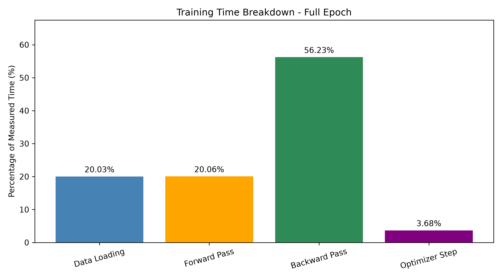

### Task 3 – Data Loading

| Number of Workers | Throughput (samples/s) |
|---|---:|
| 0 | 4628.10 |
| 1 | 4019.67 |
| 2 | 4098.40 |
| 4 | 4041.59 |
| 8 | 3536.46 |

The best configuration on the tested system
was num_workers = 0.

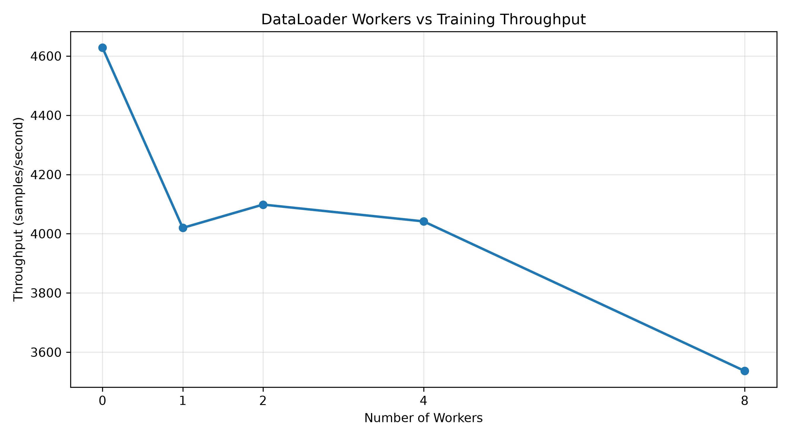

### Task 4 – Batch Size Comparison

| Batch Size | Test Accuracy | Throughput | Peak Memory (MiB) |
|---|---:|---:|---:|
| 32 | 91.25% | 4212.77 | 595.50 |
| 64 | 90.42% | 4615.00 | 603.56 |
| 128 | 89.59% | 4843.28 | 600.81 |
| 256 | 88.67% | 5090.68 | 614.09 |
| 512 | 86.82% | 5010.43 | 756.58 |

Batch size 32 achieved the highest test accuracy,
while batch size 256 achieved the highest throughput.

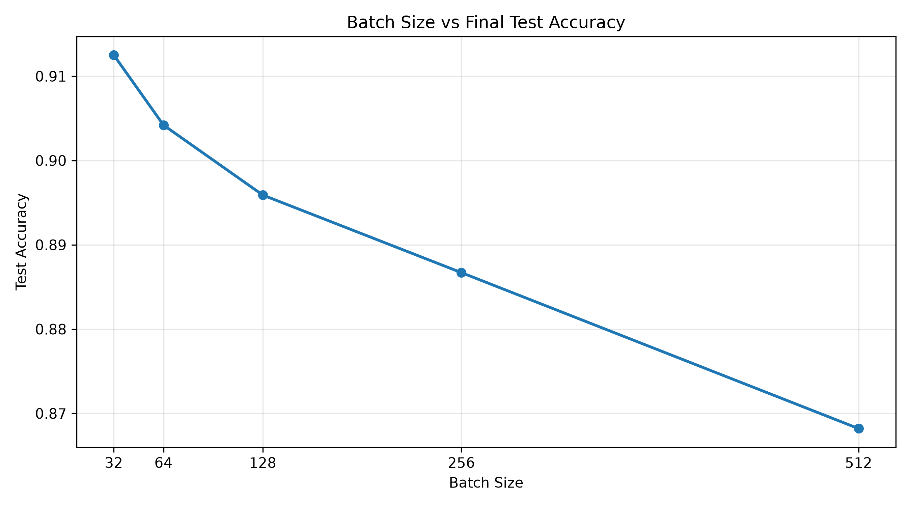

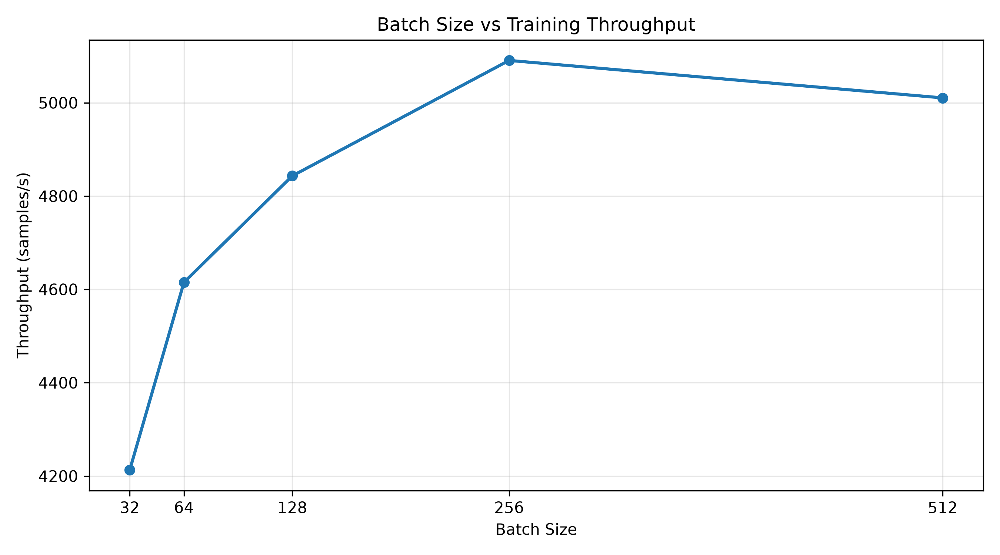

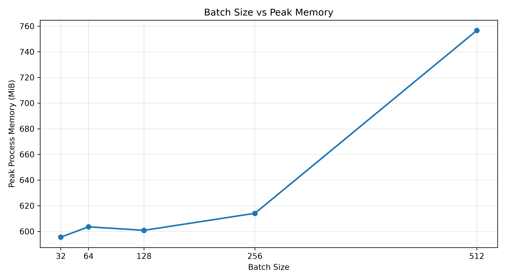

### Task 5 – Optimizer and Scheduler Comparison

| Optimizer | Scheduler | Validation Accuracy | Test Accuracy |
|---|---|---:|---:|
| Adam | StepLR | 91.22% | 90.96% |
| Adam | CosineAnnealingLR | 91.25% | 90.98% |
| Adam | ReduceLROnPlateau | 90.97% | 90.42% |
| SGD | StepLR | 90.65% | 89.97% |
| SGD | CosineAnnealingLR | 90.55% | 89.96% |
| SGD | ReduceLROnPlateau | 90.63% | 90.27% |

Adam with CosineAnnealingLR achieved the highest
final validation accuracy among the tested
configurations.

The initial learning rates were 0.001 for Adam
and 0.01 for SGD with momentum.

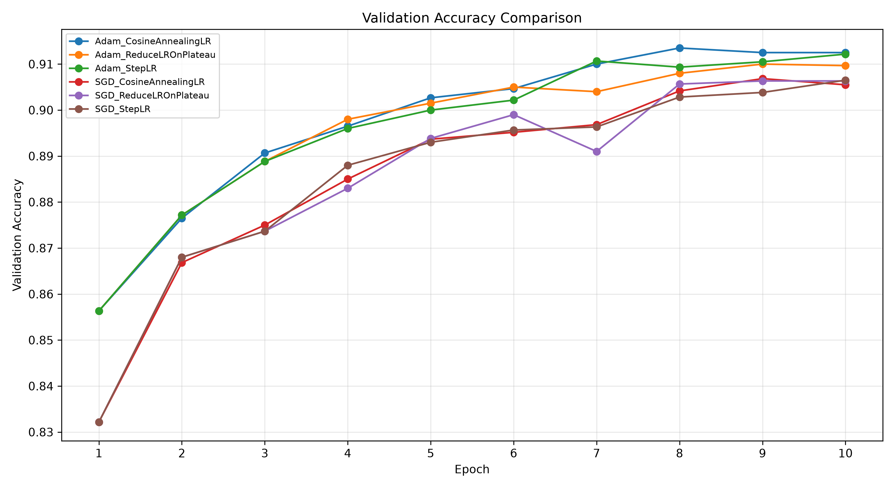

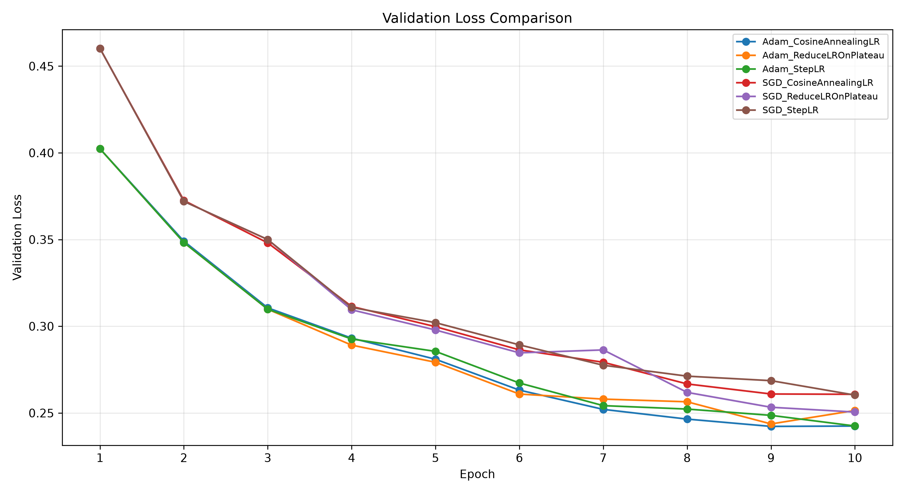

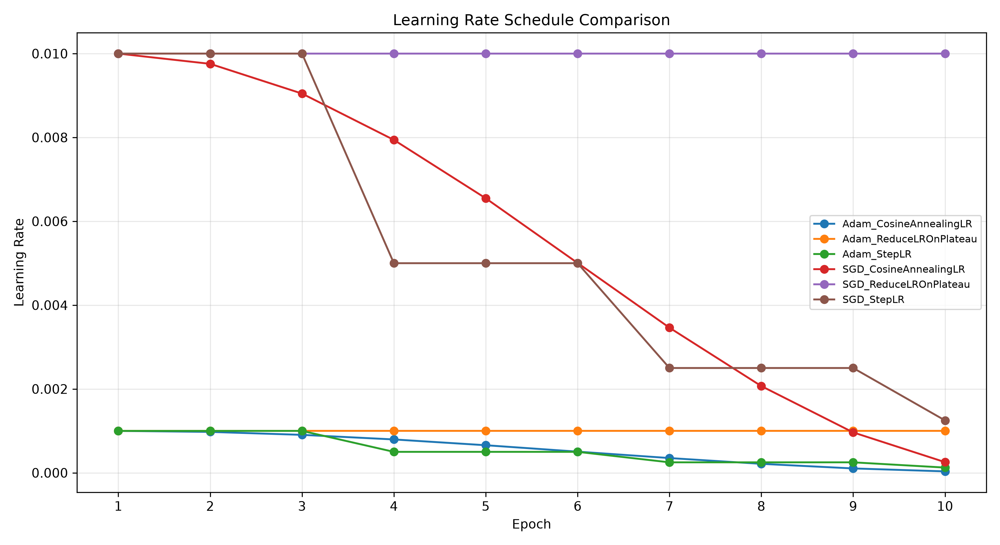

### Task 6 – Gradient Accumulation

| Metric | Normal Training | Gradient Accumulation |
|---|---:|---:|
| Batch size | 256 | 64 |
| Accumulation steps | 1 | 4 |
| Effective batch size | 256 | 256 |
| Test accuracy | 88.63% | 88.48% |
| Peak memory (MiB) | 673.05 | 640.16 |
| Training time (s) | 58.69 | 64.53 |
| Optimizer steps | 1175 | 1175 |

Gradient accumulation reduced peak process memory
by approximately 4.89%, with an accuracy difference
of only 0.15 percentage points.

However, training time increased by approximately
9.95%.

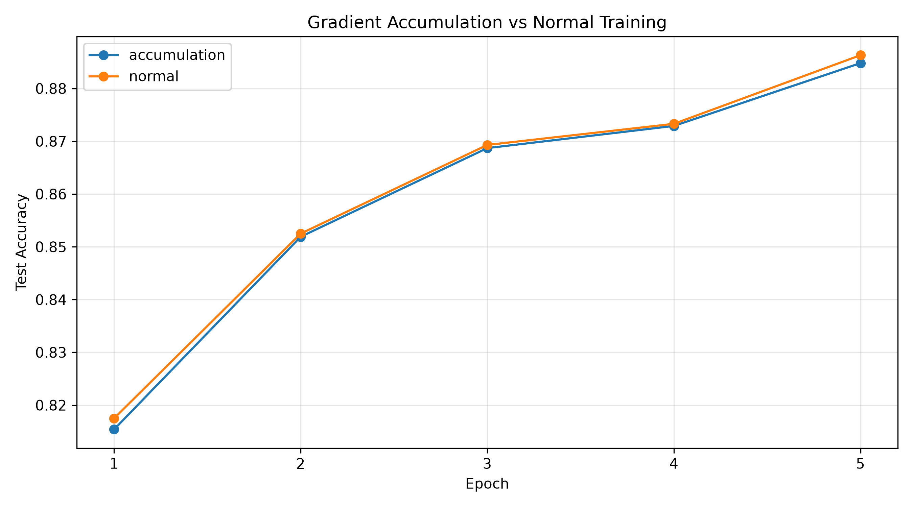

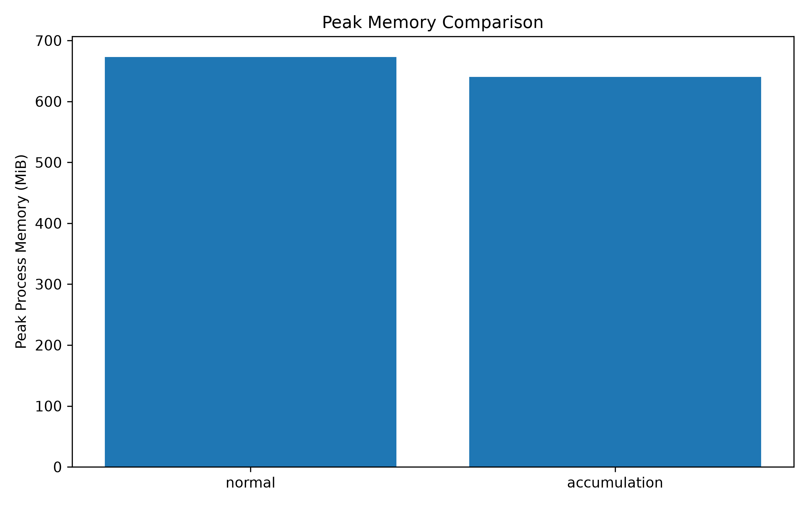

### Task 7 – Checkpoint Recovery

Training was interrupted after epoch 3 and resumed
from epoch 4 using a saved checkpoint.

| Metric | Result |
|---|---:|
| Continuous training accuracy | 91.25% |
| Resumed training accuracy | 91.25% |
| Maximum accuracy difference | 0 |
| Maximum loss difference | 0 |
| Maximum model weight difference | 0 |

Checkpoint recovery successfully reproduced the
continuous training results under the tested
configuration.

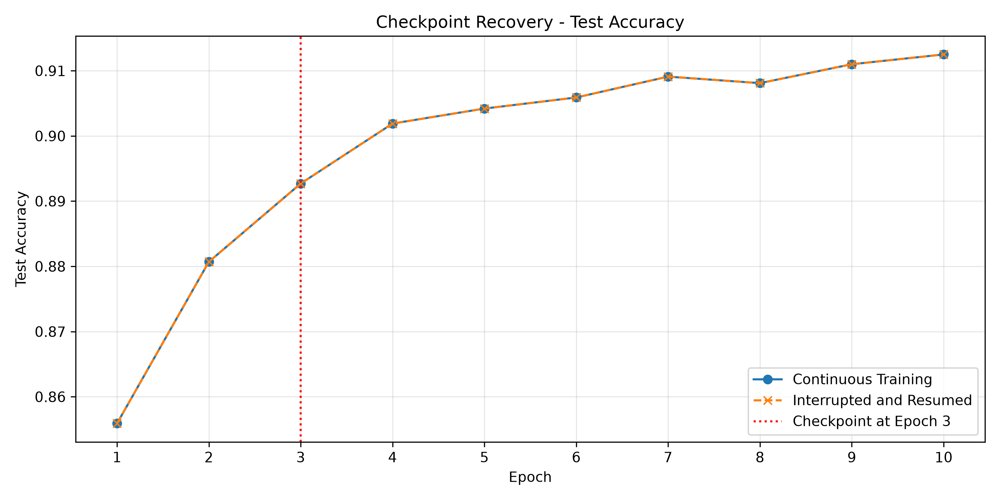

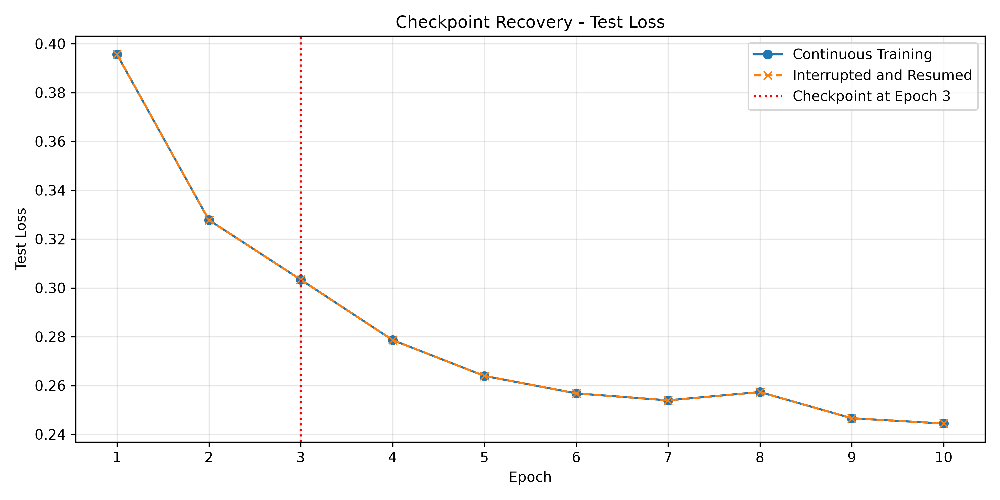

### Task 8 – Individual Project Proposal

**Project Title:** AI-Based Vehicle Fuel Consumption Prediction

The proposed project uses a lightweight
Multi-Layer Perceptron to estimate vehicle fuel
consumption from vehicle characteristics.

Planned optimization: INT8 quantization.

Target requirements:

- MAE: 1 L/100 km or lower
- R2 score: 0.90 or higher
- Model size: 5 MB or smaller
- Inference latency: 50 ms or lower

These values are proposed targets, not measured
project results.

[Individual Project Proposal (PDF)](Individual_Project_Proposal_73841.pdf)

## 8. MLflow Experiment Tracking

Start the MLflow interface:

```bash
mlflow ui --backend-store-uri sqlite:///mlflow.db --host 127.0.0.1 --port 5001
```

Open the following address in a web browser:

http://127.0.0.1:5001

Experiment name: `Lab6_73841`

MLflow records training parameters, metrics,
learning curves, and experiment artifacts.

## 9. Repository Structure

```text
lab06/
├── config.yaml
├── model.py
├── train.py
├── profiling.py
├── worker_study.py
├── batch_study.py
├── optimizer_study.py
├── accumulation_study.py
├── checkpoint_recovery.py
├── requirements.txt
├── README.md
├── report.md
├── .gitignore
├── Individual_Project_Proposal_73841.pdf
└── results/
```

Datasets, local checkpoints, virtual environments,
and local MLflow storage are generated during
experiment execution.

## 10. Conclusion

The experiments demonstrate the trade-offs between
training accuracy, computational performance,
memory consumption, and reproducibility.

Smaller batches achieved higher accuracy, while
larger batches improved training throughput.

Gradient accumulation reduced measured peak memory
with a small accuracy difference.

Checkpoint recovery successfully restored the
training process without any observed difference
in the final model weights.

The results are specific to the tested hardware,
dataset, model, and training configurations.

## Author

Eyup Yahya Suzen – 73841

Vistula University – 2026
