# Laboratory Report – Lab 06
## Reproducible Training and Performance Optimization

**Student Name:** Eyup Yahya Suzen  
**Student ID:** 73841  
**University:** Vistula University  
**Course:** Machine Learning [CII5SE039CI]  
**Group:** 01  
**Date:** 28 November 2026  

---

## 1. Introduction

The objective of this laboratory was to investigate 
reproducible machine learning training pipelines and 
performance optimization techniques.

The experiments focused on configuration-driven training,
experiment tracking, performance profiling, data loading,
batch size selection, optimizer and scheduler comparison,
gradient accumulation, and checkpoint recovery.

A convolutional neural network based on the Lab 3 model
was used for image classification on the Fashion-MNIST
dataset.

## 2. Experimental Setup

### 2.1 Hardware and Software

| Component | Configuration |
|---|---|
| Computer | Apple Silicon MacBook Air |
| Operating System | macOS |
| Programming Language | Python 3.11 |
| Deep Learning Framework | PyTorch 2.15.0 |
| Torchvision | 0.29.2 |
| Experiment Tracking | MLflow 3.18.0 |
| Training Device | CPU |
| Random Seed | 42 |
| IDE | Visual Studio Code |

### 2.2 Dataset

The Fashion-MNIST dataset was used for all technical
experiments.

- Training samples: 60,000
- Test samples: 10,000
- Image size: 28 x 28 pixels
- Input channels: 1
- Number of classes: 10

Images were converted into tensors and normalized
before training.

For Task 5, the original training dataset was divided
into 54,000 training samples and 6,000 validation samples.

### 2.3 Model Architecture

The EyupLeNetVariant CNN architecture contains the
following layers:

| Layer | Configuration |
|---|---|
| Input | 1 x 28 x 28 |
| Convolution 1 | 16 filters, kernel size 5 |
| Activation | ReLU |
| Average Pooling | 2 x 2 |
| Convolution 2 | 32 filters, kernel size 5 |
| Activation | ReLU |
| Average Pooling | 2 x 2 |
| Flatten | 800 features |
| Fully Connected 1 | 120 neurons |
| Activation | ReLU |
| Fully Connected 2 | 10 output classes |

Cross-entropy loss was used for classification.

---

## 3. Task 1 – Reproducible Training Pipeline

### Methodology

The training pipeline was organized into separate
configuration, model, and training files.

The YAML configuration file defines the dataset,
model settings, training parameters, scheduler,
checkpoint settings, and MLflow configuration.

A fixed random seed was used to improve reproducibility.

MLflow was used to track experiment parameters,
training metrics, evaluation metrics, and artifacts.

### Baseline Configuration

| Parameter | Value |
|---|---|
| Batch size | 64 |
| Number of workers | 0 |
| Epochs | 10 |
| Optimizer | Adam |
| Initial learning rate | 0.001 |
| Scheduler | StepLR |
| Step size | 3 |
| Gamma | 0.5 |
| Seed | 42 |

### Results

| Epoch | Training Loss | Training Accuracy | Test Loss | Test Accuracy |
|---|---:|---:|---:|---:|
| 1 | 0.5262 | 80.72% | 0.3956 | 85.59% |
| 2 | 0.3419 | 87.64% | 0.3278 | 88.07% |
| 3 | 0.2965 | 89.10% | 0.3034 | 89.27% |
| 4 | 0.2533 | 90.79% | 0.2786 | 90.19% |
| 5 | 0.2408 | 91.12% | 0.2639 | 90.42% |
| 6 | 0.2269 | 91.74% | 0.2568 | 90.59% |
| 7 | 0.2065 | 92.34% | 0.2539 | 90.91% |
| 8 | 0.1997 | 92.68% | 0.2573 | 90.81% |
| 9 | 0.1939 | 92.85% | 0.2466 | 91.10% |
| 10 | 0.1825 | 93.31% | 0.2444 | 91.25% |

### Discussion

The baseline model achieved a final test accuracy
of 91.25%.

Training and test losses generally decreased during
the experiment, indicating successful learning.

Checkpoint files were saved after each epoch.
The final model was approximately 436 KiB on disk.

MLflow recorded the configuration, parameters,
metrics, and final model artifact.

---

## 4. Task 2 – Performance Profiling

### Methodology

PyTorch Profiler was used to analyze one complete
training epoch consisting of 938 batches.

The profiling process measured four main stages:

- Data loading
- Forward pass
- Backward pass
- Optimizer step

Profiling was performed in smaller chunks of
20 batches to reduce profiler event-processing overhead.

All 938 batches were included in the final measurements.

### Results

| Operation | Time (s) | Time Share |
|---|---:|---:|
| Data loading | 2.8562 | 20.03% |
| Forward pass | 2.8597 | 20.06% |
| Backward pass | 8.0179 | 56.23% |
| Optimizer step | 0.5241 | 3.68% |
| Total measured time | 14.2579 | 100% |

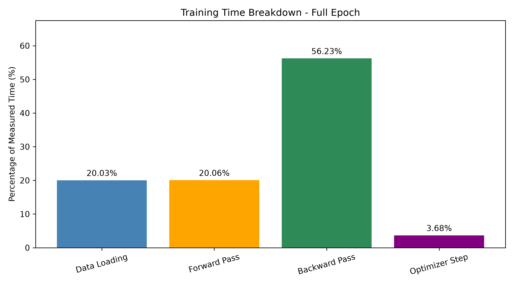

### Discussion

The backward pass was the largest measured
computational component, representing 56.23%
of the total measured operation time.

The forward pass and data loading each represented
approximately 20% of the measured time.

The optimizer step represented the smallest share.

These percentages describe the four measured
operations rather than the complete profiler
wall-clock execution time.

The results suggest that improving backward-pass
computation could provide the largest potential
performance benefit for this configuration.

---

## 5. Task 3 – Data Loading Performance

### Methodology

Five DataLoader worker configurations were evaluated:

0, 1, 2, 4, and 8 workers.

Each configuration used the same model, dataset,
batch size, optimizer, and random seed.

Each experiment processed 60,000 training samples
during one training epoch.

### Results

| Workers | Epoch Time (s) | Data Loading (s) | Loading Share | Throughput (samples/s) |
|---|---:|---:|---:|---:|
| 0 | 12.9643 | 2.1113 | 16.29% | 4628.10 |
| 1 | 14.9266 | 3.5530 | 23.80% | 4019.67 |
| 2 | 14.6399 | 3.1704 | 21.66% | 4098.40 |
| 4 | 14.8456 | 3.3811 | 22.77% | 4041.59 |
| 8 | 16.9661 | 5.3580 | 31.58% | 3536.46 |

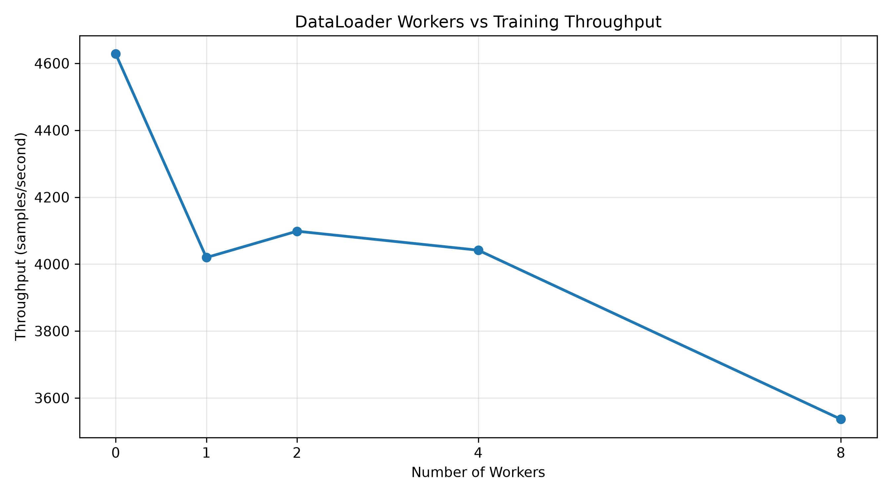

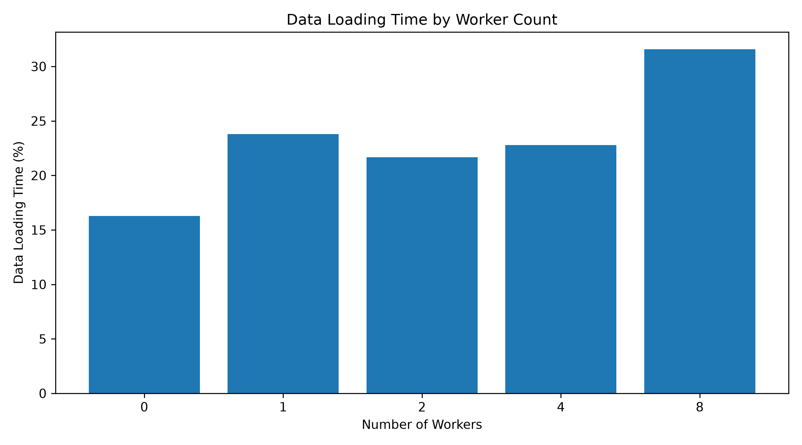

### Discussion

The configuration with zero workers achieved the
highest throughput and the shortest epoch time.

Increasing the number of workers did not improve
performance on the tested system.

One possible explanation is the multiprocessing
overhead associated with small images and relatively
simple preprocessing operations.

Therefore, num_workers = 0 was selected for the
remaining experiments.

---

## 6. Task 4 – Batch Size Study

### Methodology

Five batch sizes were evaluated:

32, 64, 128, 256, and 512.

Each configuration was trained for five epochs
using Adam and StepLR.

The experiments measured test accuracy, training
throughput, training time, and peak process memory.

Separate Python processes were used for individual
configurations to reduce interference between
peak memory measurements.

### Results

| Batch Size | Training Time (s) | Throughput (samples/s) | Peak Memory (MiB) | Test Accuracy |
|---|---:|---:|---:|---:|
| 32 | 71.21 | 4212.77 | 595.50 | 91.25% |
| 64 | 65.01 | 4615.00 | 603.56 | 90.42% |
| 128 | 61.94 | 4843.28 | 600.81 | 89.59% |
| 256 | 58.93 | 5090.68 | 614.09 | 88.67% |
| 512 | 59.88 | 5010.43 | 756.58 | 86.82% |

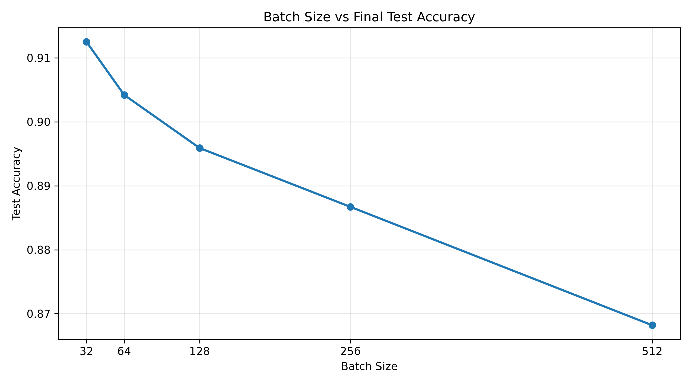

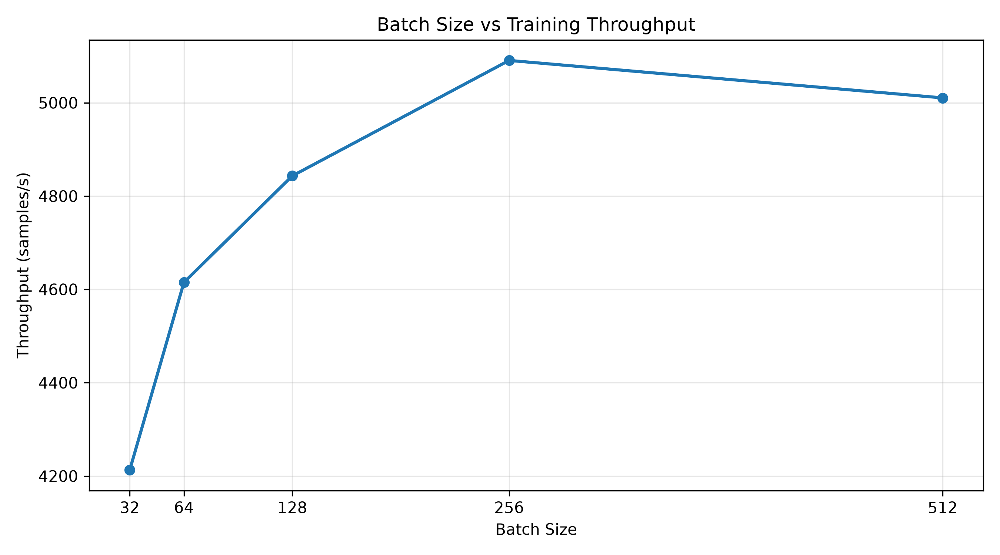

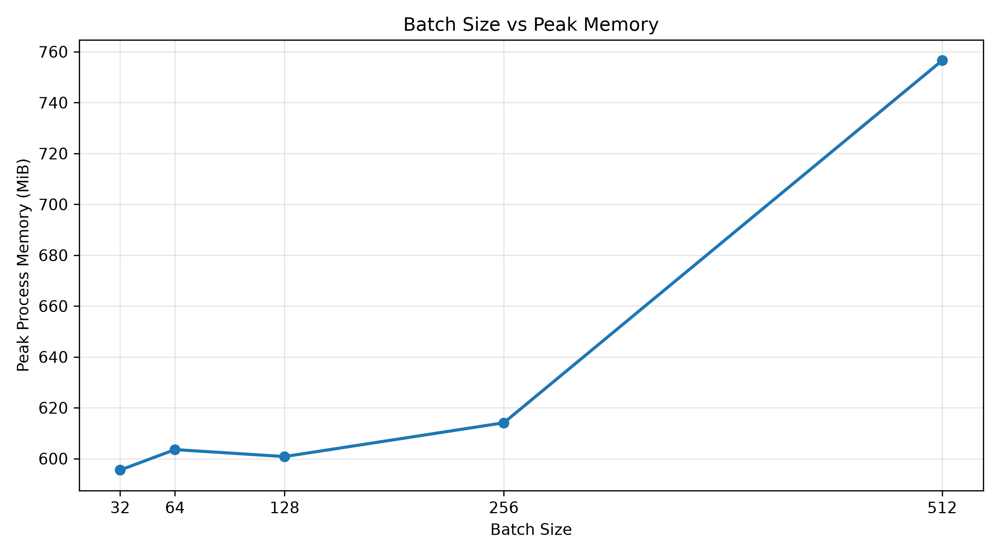

### Discussion

Batch size 32 achieved the highest test accuracy
and the lowest measured peak process memory.

Batch size 256 achieved the highest training
throughput.

Increasing the batch size to 512 increased memory
consumption without improving throughput.

Smaller batches also performed more optimizer
updates per epoch. Therefore, an equal number
of epochs does not represent an equal number
of optimizer updates.

Batch size 64 provided a practical balance between
accuracy and training throughput for the tested system.

---

## 7. Task 5 – Optimizer and Scheduler Study

### Methodology

Two optimizers were compared:

- Adam
- SGD with momentum

Three learning rate schedulers were evaluated:

- StepLR
- CosineAnnealingLR
- ReduceLROnPlateau

Six combinations were trained for ten epochs each,
resulting in a total of 60 training epochs.

The same training and validation split and random
seed were used for all configurations.

Adam used an initial learning rate of 0.001.
SGD used an initial learning rate of 0.01 and
momentum of 0.9.

ReduceLROnPlateau monitored validation loss.

The best configuration was selected using final
validation accuracy rather than test accuracy.

### Results

| Optimizer | Scheduler | Validation Accuracy | Test Accuracy | Test Loss | Training Time (s) |
|---|---|---:|---:|---:|---:|
| Adam | StepLR | 91.22% | 90.96% | 0.2528 | 114.75 |
| Adam | CosineAnnealingLR | 91.25% | 90.98% | 0.2501 | 115.57 |
| Adam | ReduceLROnPlateau | 90.97% | 90.42% | 0.2652 | 113.69 |
| SGD | StepLR | 90.65% | 89.97% | 0.2761 | 116.25 |
| SGD | CosineAnnealingLR | 90.55% | 89.96% | 0.2745 | 121.09 |
| SGD | ReduceLROnPlateau | 90.63% | 90.27% | 0.2676 | 135.18 |

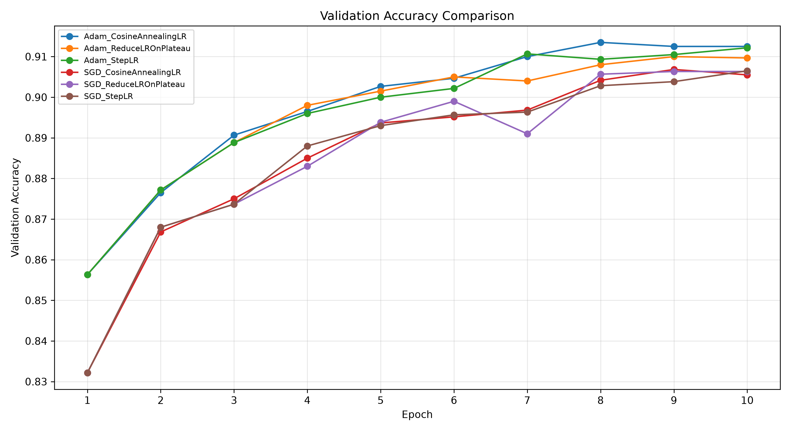

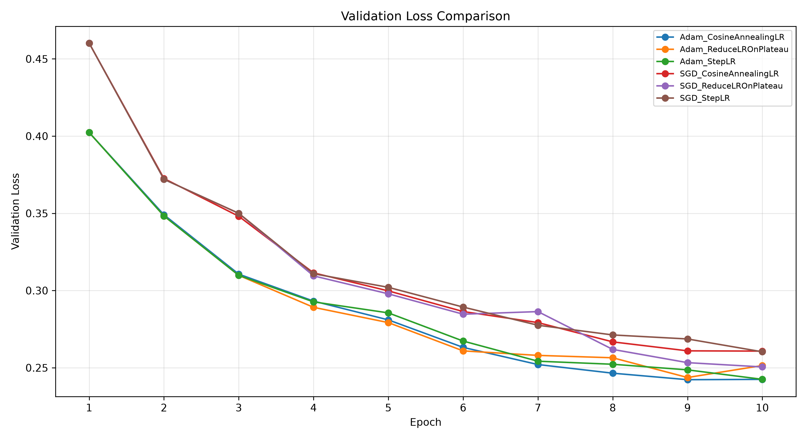

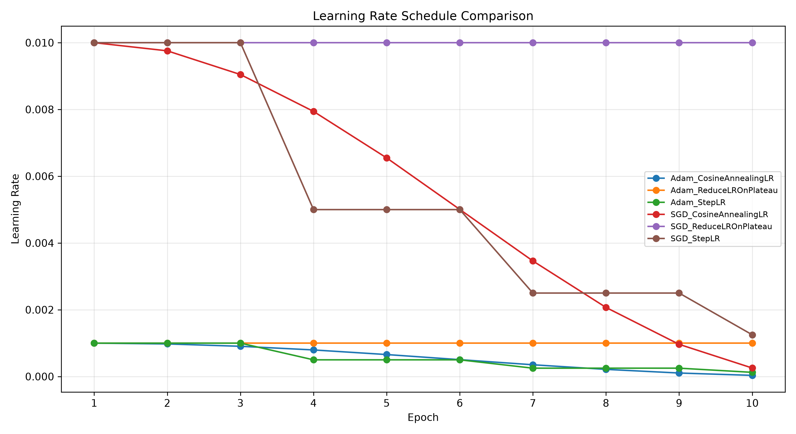

### Discussion

Adam combined with CosineAnnealingLR achieved
the highest final validation accuracy of 91.25%
and a test accuracy of 90.98%.

Adam combined with StepLR achieved very similar
results.

Adam performed better than the tested SGD
configurations in terms of final validation accuracy.

ReduceLROnPlateau did not reduce the learning
rate used during the ten training epochs in
either optimizer experiment.

The results are specific to the selected learning
rates and scheduler settings. They do not establish
that Adam is universally superior to SGD.

---

## 8. Task 6 – Gradient Accumulation

### Methodology

Two training configurations were compared:

1. Standard training with batch size 256.
2. Gradient accumulation with batch size 64
   and four accumulation steps.

Both methods used an effective batch size of 256.

Effective batch size = batch size x accumulation steps

Gradients were accumulated across mini-batches
and normalized by the number of accumulated
samples before each optimizer update.

The final incomplete accumulation window was
also handled.

Both configurations were trained for five epochs.

### Results

| Metric | Standard Training | Gradient Accumulation |
|---|---:|---:|
| Physical batch size | 256 | 64 |
| Accumulation steps | 1 | 4 |
| Effective batch size | 256 | 256 |
| Total optimizer steps | 1175 | 1175 |
| Training accuracy | 88.85% | 88.79% |
| Test accuracy | 88.63% | 88.48% |
| Test loss | 0.3267 | 0.3278 |
| Training time (s) | 58.69 | 64.53 |
| Throughput (samples/s) | 5111.30 | 4648.83 |
| Peak memory (MiB) | 673.05 | 640.16 |

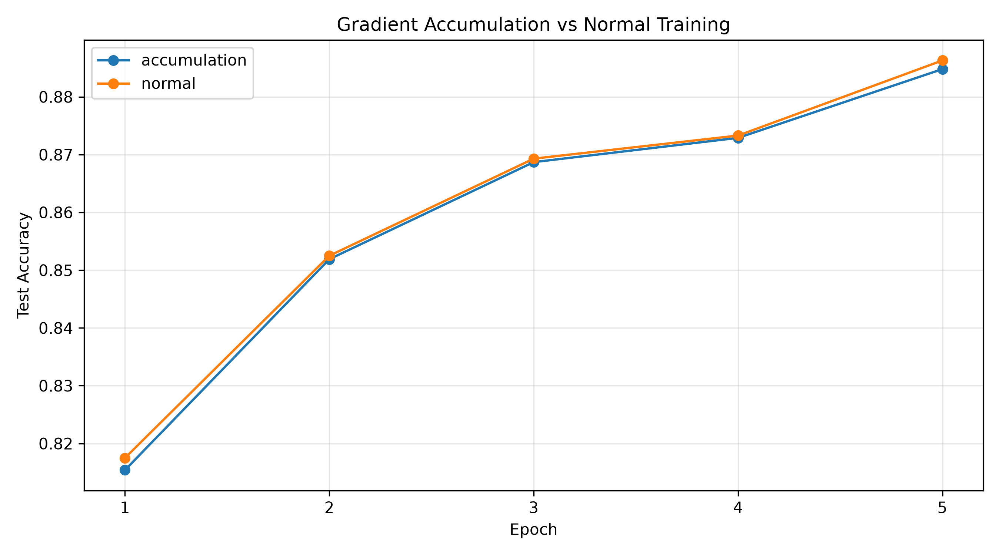

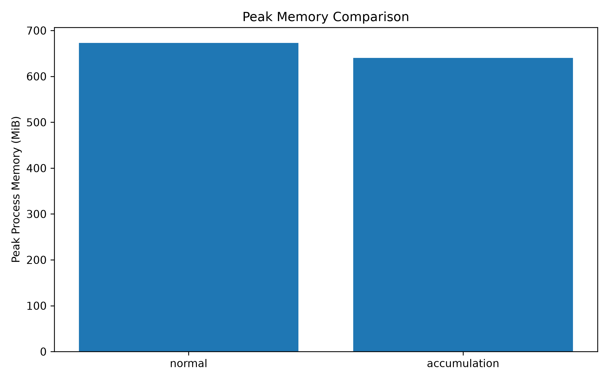

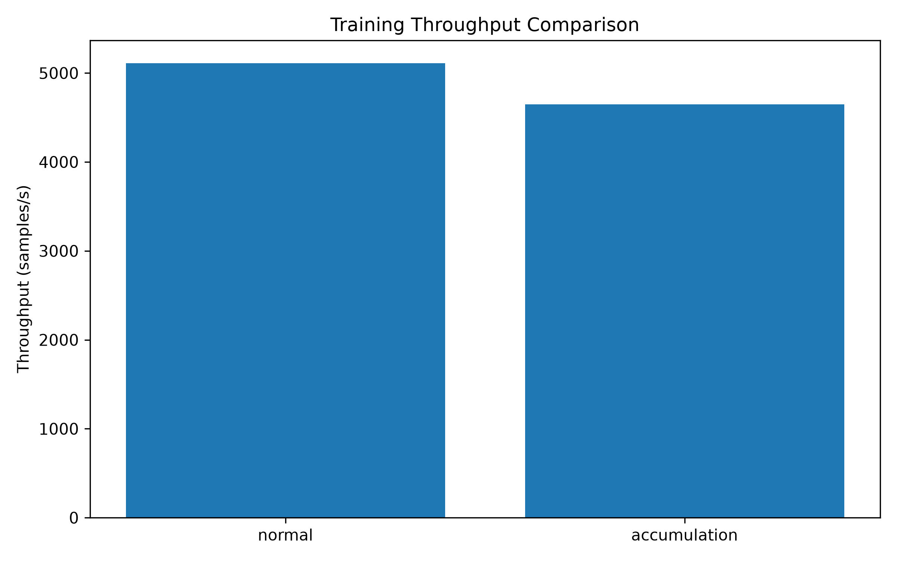

### Discussion

Gradient accumulation reduced peak process
memory consumption by approximately 32.89 MiB,
equivalent to a 4.89% reduction.

The difference in final test accuracy was only
0.15 percentage points.

Both methods performed exactly 1175 optimizer
updates.

However, gradient accumulation increased training
time by approximately 9.95%.

The experiment demonstrates that gradient
accumulation can approximate large-batch
training while using smaller physical batches.

The measured memory reduction refers to total
process memory rather than model activation
memory alone.

---

## 9. Task 7 – Checkpoint Recovery

### Methodology

Two training scenarios were evaluated:

- Continuous training for ten epochs.
- Training interrupted after epoch 3 and
  resumed from epoch 4.

A controlled interruption was implemented using
separate Python processes.

The checkpoint included:

- Model parameters
- Optimizer state
- Scheduler state
- Current epoch
- PyTorch random number generator state
- Python random number generator state
- NumPy random number generator state
- DataLoader random generator state
- Training history

After loading the checkpoint, training continued
from epoch 4.

### Results

| Epoch | Continuous Accuracy | Resumed Accuracy | Difference |
|---|---:|---:|---:|
| 1 | 85.59% | 85.59% | 0 |
| 2 | 88.07% | 88.07% | 0 |
| 3 | 89.27% | 89.27% | 0 |
| 4 | 90.19% | 90.19% | 0 |
| 5 | 90.42% | 90.42% | 0 |
| 6 | 90.59% | 90.59% | 0 |
| 7 | 90.91% | 90.91% | 0 |
| 8 | 90.81% | 90.81% | 0 |
| 9 | 91.10% | 91.10% | 0 |
| 10 | 91.25% | 91.25% | 0 |

### Recovery Summary

| Metric | Result |
|---|---:|
| Interruption epoch | 3 |
| Recovery start epoch | 4 |
| Continuous final accuracy | 91.25% |
| Resumed final accuracy | 91.25% |
| Maximum accuracy difference | 0 |
| Maximum test loss difference | 0 |
| Maximum model weight difference | 0 |

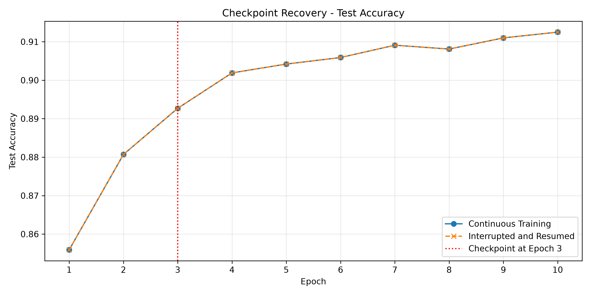

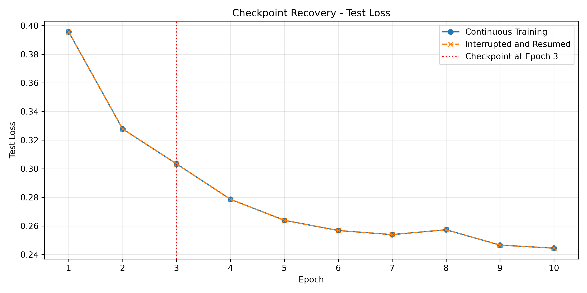

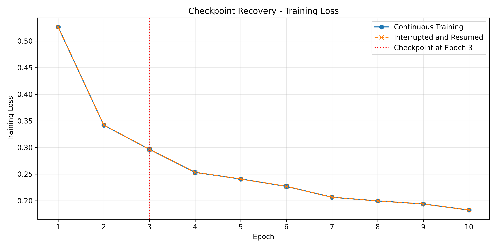

### Discussion

Checkpoint recovery successfully restored
the training process.

The continuous and resumed training curves
were identical.

The maximum observed difference between the
final model weights was zero.

This demonstrates that the required training
states were successfully restored under the
tested deterministic CPU configuration.

Checkpoint recovery can help prevent the loss
of completed training progress when a training
process is interrupted.

---

## 10. Task 8 – Individual Project Proposal

### Project Title

AI-Based Vehicle Fuel Consumption Prediction

### Problem and Motivation

The proposed project aims to estimate vehicle
fuel consumption using machine learning.

The system will predict standardized combined
fuel consumption in liters per 100 kilometers
based on vehicle characteristics.

### Dataset

The proposed dataset is the Canadian Fuel
Consumption Ratings dataset.

Potential input features include:

- Engine size
- Number of cylinders
- Transmission type
- Fuel type

The target variable is combined fuel consumption.

### Proposed Model

A lightweight Multi-Layer Perceptron will be
implemented using PyTorch.

The problem will be treated as a regression task.

The model will use mean squared error during
training and will be evaluated using MAE and
R2 score.

### Planned Optimization

INT8 quantization will be investigated to reduce
model size and improve deployment efficiency.

### Success Metrics and Deployment Constraints

| Metric | Target |
|---|---|
| Mean Absolute Error | <= 1 L/100 km |
| R2 score | >= 0.90 |
| Model size | <= 5 MB |
| Inference latency | <= 50 ms |
| Deployment platform | CPU-based application |
| User interface | Streamlit |

These values represent proposed project targets,
not experimentally measured results.

The individual project is separate from the
Fashion-MNIST experiments conducted in Tasks 1–7.

The formal one-page project proposal is available
in the following PDF:

[Individual Project Proposal](Individual_Project_Proposal_73841.pdf)

Instructor approval has not yet been confirmed.

---

## 11. Limitations

The experiments were conducted on a single
CPU-based Apple Silicon system.

The performance measurements may differ on
other processors, GPUs, operating systems,
or datasets.

The experiments used a fixed random seed
rather than multiple independent training runs.

Therefore, statistical variability across
different seeds was not evaluated.

Peak memory measurements represent the
resident memory of the complete Python process.

Profiler instrumentation introduced additional
execution overhead.

The batch size experiments used equal epoch
budgets rather than equal optimizer update counts.

Repeated test-set evaluations provide descriptive
comparisons, but a separate validation set would
be preferable for general hyperparameter selection.

The individual project performance targets
have not yet been experimentally verified.

---

## 12. Conclusion

This laboratory demonstrated the implementation
of reproducible training pipelines and performance
optimization techniques using PyTorch and MLflow.

The baseline CNN achieved a test accuracy of 91.25%.

Performance profiling identified the backward
pass as the largest measured computational component.

The data loading study showed that zero workers
provided the best throughput on the tested system.

Batch size 32 achieved the highest accuracy in the
batch size study, while batch size 256 achieved
the highest throughput.

Adam combined with CosineAnnealingLR achieved
the highest final validation accuracy in the
optimizer and scheduler study.

Gradient accumulation reduced peak process
memory consumption while maintaining similar
classification accuracy.

Checkpoint recovery successfully reproduced
continuous training with no observed differences
in accuracy, test loss, or final model weights.

Overall, the experiments highlight the importance
of balancing model accuracy, training throughput,
memory consumption, and reproducibility when
developing machine learning systems.

---

## 13. References

1. Laboratory Manual – Lab 06, Machine Learning,
   Vistula University.

2. PyTorch Documentation.
   https://pytorch.org/docs/stable/index.html

3. MLflow Documentation.
   https://mlflow.org/docs/latest/

4. Fashion-MNIST Dataset.
   https://github.com/zalandoresearch/fashion-mnist

5. Vijay Janapa Reddi, Introduction to Machine
   Learning Systems: Principles and Practices of
   Engineering Artificially Intelligent Systems.

---

**Prepared by:** Eyup Yahya Suzen  
**Student ID:** 73841  
**Vistula University, 2026**
